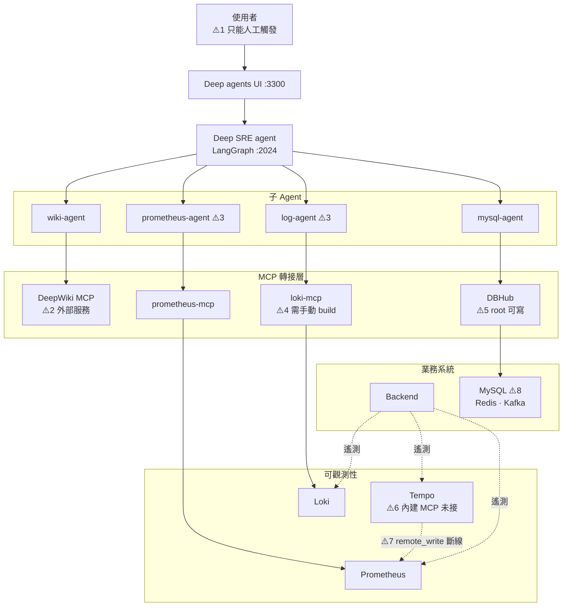
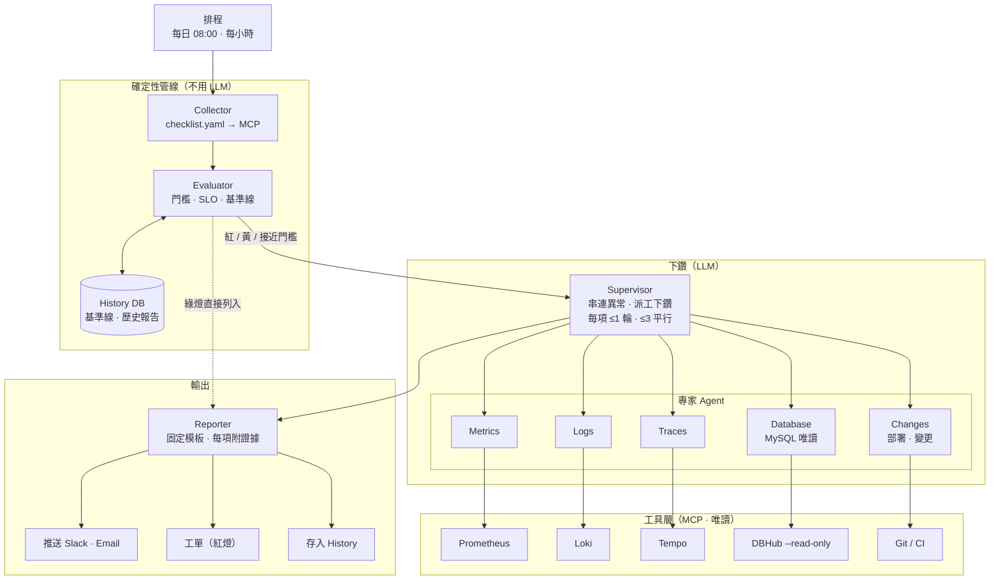

# SRE Agent 主動巡檢設計

> 以 [vapering/SRE-Agent](https://github.com/vapering/SRE-Agent) 為基礎，改造成「自動化巡檢與健康報告」的 multi-agent 系統。
> 本文件整理自原 repo 的程式碼分析與後續設計討論。

## 目錄

1. [原 repo 分析](#1-原-repo-分析)
2. [設計決策](#2-設計決策)
3. [目標架構：主動巡檢](#3-目標架構主動巡檢)
4. [巡檢項目設計](#4-巡檢項目設計)
5. [怎樣算異常](#5-怎樣算異常)
6. [預處理輸出格式](#6-預處理輸出格式)
7. [前置條件與導入路線](#7-前置條件與導入路線)
8. [參考資料](#8-參考資料)

---

## 1. 原 repo 分析

### 1.1 定位

`SRE-Agent` 是一個用 LLM 做**故障根因分析（RCA）**的實驗平台。`需求文档.md` 明確寫到，內附的秒殺商城（Flash Sale Mall）是「SRE Agent 故障根因分析的測試環境」。

它在 SRE 事件處理流程中只負責「診斷」：

| 階段 | 原 repo 是否涵蓋 |
|---|---|
| 偵測（發現出事） | ❌ 沒有告警，靠人發現 |
| **診斷與 RCA** | ✅ 唯一的工作 |
| 修復與緩解 | ❌ 只給建議 |
| 事後檢討 | 部分（報告可當 postmortem 草稿） |

### 1.2 技術組成

| 層 | 內容 |
|---|---|
| 業務系統 | Spring Boot 3.3 / Java 21、React 18、MySQL、Redis、Kafka |
| 可觀測性 | Prometheus（+ mysql / redis exporter）、Loki + Promtail、Tempo、Grafana |
| MCP 轉接 | `prometheus-mcp-server`、`bytebase/dbhub`、`loki-mcp-server`、DeepWiki（外部） |
| Agent | `deepagents` + LangGraph；主 Agent + wiki / log / prometheus / mysql 四個子 Agent |
| 故障注入 | `loadtest-service` 對 `seckill_goods` 下 `LOCK TABLES ... WRITE` |

### 1.3 現況架構與問題點



| # | 問題 | 說明 |
|---|---|---|
| 1 | 只能人工觸發 | `rule_files` 被註解、沒有 Alertmanager，要有人看到異常才會叫 Agent |
| 2 | wiki 依賴外部服務 | 故障描述送到 DeepWiki；查的是另一個 repo（`vapering/FlashSaleMall`）的靜態快照 |
| 3 | 工具與參數問題 | 時間範圍、limit、labels 都標成 `InjectedToolArg`，LLM 無法指定；`prom_list_metrics`、`prom_health_check` 寫在 prompt 但沒註冊；P95 範例指標在本系統不存在 |
| 4 | loki-mcp 無法直接啟動 | compose 只有 image 名稱，沒有 build context |
| 5 | DBHub 用 root 且可寫 | `--read-only` 被註解，也沒開 `interrupt_on`，LLM 可直接改資料 |
| 6 | Tempo 未接入 | 內建 MCP server 已開，但沒有任何子 Agent 使用 |
| 7 | remote_write 大概是斷的 | Tempo 的 span-metrics / service-graphs 要寫入 Prometheus，但 Prometheus 沒開 `--web.enable-remote-write-receiver` |
| 8 | Redis、Kafka 無法深入排查 | 只有 exporter 指標，沒有對應的子 Agent；Kafka 連 exporter 都沒有 |

其他觀察：

- **安全性**：compose 中密碼與 JWT secret 寫死（`root123`、`change-me-in-prod`），所有 port 對外開放；故障注入 API 把 request body 的表名直接拼進 SQL。
- **程式碼**：模型寫死 `gpt-5.2`；`sre_think_tool`、`SRE_TASK_DESCRIPTION_PREFIX`、`MemorySaver` 等定義了但沒用到；每次工具呼叫都重建 MCP 連線。
- **測試情境**：需求文件規劃了連線池洩漏、Kafka 積壓、快取擊穿、限流等故障，但只實作了鎖表一種。

### 1.4 Agent 怎麼決定要查什麼

**沒有任何路由程式碼**，全靠 LLM 讀 prompt 後自行判斷，資訊來源有四種：

1. **主 Agent 的 SOP**（`prompts.py` 的 `SRE_WORKFLOW_INSTRUCTIONS`）：固定流程「記錄 → 問 wiki → 定計畫 → 派工 → 彙整 → 寫報告」，以及「log 查日誌、prometheus 查指標、mysql 查死鎖」的分工。
2. **子 Agent 的 `description`**（`agent.py`）：`deepagents` 會把名稱和一句話描述放進 `task` 工具的說明。
3. **wiki-agent 的建議**：從程式碼推斷可能的故障點與排查方向。
4. **LLM 的通用 SRE 知識**：症狀與資料來源的對應（慢 → 延遲指標、報錯 → 日誌、卡住 → DB 鎖）。

派工策略寫在 `SRE_SUBAGENT_DELEGATION_INSTRUCTIONS`：預設只派 1 個子 Agent、最多 3 個平行、最多 3 輪。

---

## 2. 設計決策

### 2.1 拿掉 wiki-agent 與 RAG

| | 有 wiki-agent | 沒有 |
|---|---|---|
| 速度與成本 | 多一輪 LLM + 一次外部呼叫 | 較快 |
| 資料外流 | 故障描述送到外部 | 全在本地 |
| 被誤導風險 | 有（另一個 repo 的靜態快照） | 無 |
| 呼叫鏈知識 | 有 | 需改由 trace 取得 |

在這個規模的系統，wiki 的價值有限。替代方案：

- **執行時偵察**：從 `prom_list_targets`、指標清單、Tempo service graph、DB schema 取得「系統現在長什麼樣」，比文件更準。
- **prompt 內的靜態摘要**（不是 RAG）：服務清單、下單呼叫鏈、症狀路由表、什麼算正常。

> 注意：若只從 `subagents` 移除 wiki-agent 而不改 prompt，主 Agent 仍會嘗試呼叫它，失敗後可能改派給 `deepagents` 內建的 general-purpose 子 Agent，由它憑空產出「架構分析」。必須同步修改 `prompts.py` 第 8、9、15 行與委派策略的範例。

### 2.2 從 RCA 轉向主動巡檢

| | RCA | 主動巡檢 |
|---|---|---|
| 觸發 | 出事時 | 排程 |
| 起點 | 有症狀 | 沒有症狀，全面檢查 |
| 目標 | 深挖單一根因 | 全面覆蓋所有風險 |
| 輸出 | 敘述式報告 | 結構化、可每日比較的評分表 |
| 需要的知識 | 當下資料 | 當下資料 + 基準線 + 門檻 + 歷史趨勢 |

**巡檢項目是固定的**，若讓 LLM 每次自行決定查什麼，會導致每天查的不一樣、報告無法比較、token 成本高。因此核心原則是：

> **資料收集與判定用程式完成，LLM 只負責解讀、串連異常與下鑽。**

### 2.3 原有子 Agent 的角色

子 Agent 沒有被淘汰，只是換了出場時機：

| 階段 | 使用 | 沿用的元件 |
|---|---|---|
| 固定收集 | 直接呼叫 MCP client，跳過 LLM | `*/mcp_client.py`、MCP servers |
| 判定 | 純程式 | — |
| 下鑽紅燈 | 原本的子 Agent | 整個子 Agent |
| 寫報告 | LLM（新的 prompt） | `deepagents` |

```python
from prometheus_agent.mcp_client import PrometheusMCPClient
from log_agent.mcp_client import LokiMCPClient
from mysql_agent.mcp_client import MySQLMCPClient

prom, loki, db = PrometheusMCPClient(), LokiMCPClient(), MySQLMCPClient()

for item in checklist:
    if item["source"] == "prometheus":
        item["result"] = prom.query_instant(item["query"])
    elif item["source"] == "loki":
        item["result"] = loki.query_logs(item["query"])
    elif item["source"] == "mysql":
        item["result"] = db.execute(item["query"])
```

### 2.4 「下鑽」的定義

看到某個指標異常後，往下多挖一層，把「指標異常」變成「可能原因 + 證據」。它是縮小版的 RCA：

| | 下鑽 | RCA |
|---|---|---|
| 起點 | 明確的異常指標 | 模糊的症狀 |
| 深度 | 每項最多 1 輪 | 最多 3 輪 |
| 產出 | 報告中的一兩行註解 | 完整分析報告 |

範例：

> 🔴 HikariCP 連線池使用率 96%
> 原因：有一筆交易持有 `seckill_goods` 的鎖超過 40 分鐘，下單請求都在等待（QPS 無異常）
> 證據：processlist 第 123 號連線、09:12 開始出現連線逾時錯誤 [1][2]
> 建議：確認長交易來源，必要時 kill；檢查 `GoodsCleanupJob` 是否有未提交的交易

黃燈通常不下鑽，只標示趨勢；嚴重事件升級為工單交給人處理。

---

## 3. 目標架構：主動巡檢



**護欄（橫跨所有層）**：全程唯讀 · 送 LLM 前脫敏 · 模型分層（例行用小模型，紅燈多時升級大模型）· I/O 稽核紀錄 · 巡檢失敗要告警。

### 3.1 設計重點

- **LLM 只用在需要判斷的地方**：綠燈項目走虛線直接列入報告；全部綠燈時連 Reporter 都可以只套模板。
- **multi-agent 集中在下鑽**：Supervisor 先把多個異常串起來（例如連線池滿、鎖等待、P99 升高是同一件事），再派專家 Agent。
- **新增 Traces agent**：拿掉 wiki 後，呼叫鏈只能從 trace 取得。
- **新增 Changes agent**：把異常的起點與部署時間對照，這是推斷根因最有力的線索，原 repo 完全沒有。
- **兩種頻率**：每日跑完整清單並下鑽；每小時只跑關鍵項目（可用性、業務不變量、Redis 淘汰），無紅燈不推送。
- **拿掉人工審核**：巡檢全程唯讀，不執行任何修復動作。
- **監控巡檢本身**：沒收到報告必須有人知道，否則會被誤以為一切正常。

### 3.2 對應五層架構

參考 Charles CH〈當 AI Agent 成為你的 SRE〉提出的五層架構：

| 本設計 | 五層架構 | 用不用 LLM |
|---|---|---|
| Collector | 1. 資料收集 | 否 |
| Evaluator | 2. 預處理與特徵工程 | 否 |
| Supervisor（串連、決定往哪挖） | 3. Agent 推理 | 是 |
| 專家 Agent 經 MCP 查詢 | 4. 工具呼叫 | 是 |
| Reporter + 推送 + 存檔 | 5. 報告產生 | 是 |

`checklist.yaml` 是跨層設定檔，但核心在第 1、2 層：

| 欄位 | 用於 |
|---|---|
| `source`、`query`、`window` | 1. 資料收集 |
| `eval`、`unit`、`compare` | 2. 預處理 |
| `note` | 3. 推理的背景知識 |
| `drilldown` | 4. 下鑽要派的子 Agent |
| `name`、`domain` | 5. 報告名稱與分段 |

---

## 4. 巡檢項目設計

完整清單見 [`checklist.yaml`](./checklist.yaml)（v1，共 43 項，35 項現在就能執行）。

### 4.1 方法論

| 方法論 | 出處 | 看什麼 | 用在 |
|---|---|---|---|
| 四大黃金指標 | Google《SRE》 | 延遲、流量、錯誤、飽和度 | 整體框架 |
| RED | Tom Wilkie | Rate、Errors、Duration | 處理請求的東西：API、服務間呼叫 |
| USE | Brendan Gregg | Utilization、Saturation、Errors | 資源：連線池、DB、Redis、JVM、容器 |

USE 套用範例：

| 資源 | Utilization | Saturation |
|---|---|---|
| DB 連線池 | `app.hikari_usage` | `app.hikari_pending` |
| MySQL | `mysql.connection_usage` | 鎖等待、長交易 |
| Redis | `redis.memory_usage` | `redis.evictions` |
| JVM | `app.heap_usage` | `app.gc_time_ratio` |
| Kafka consumer | — | `kafka.consumer_lag` |

此外加上四類系統特有項目：

1. **業務不變量**：超賣、重複下單、活動中沒有訂單——監控指標看不出來，只能用 SQL 對帳。
2. **已知故障模式**：需求文件規劃的每種故障都至少有一項抓得到。
3. **監控自身**：日誌中斷、Tempo 指標未寫入。
4. **指標衛生**：`route` 標籤基數。

### 4.2 分層（domain）

依「**問題出在系統的哪一層**」分成 6 層，由上到下即報告閱讀順序：

| domain | 內容 | 主要看的人 |
|---|---|---|
| 業務 | 超賣、訂單量、活動異常 | 業務、產品 |
| 服務入口 | API 的 RED、限流 | SRE |
| 應用 | JVM、連線池、重啟、應用錯誤 | 後端開發 |
| 依賴 | MySQL、Redis、Kafka、服務間呼叫 | DBA、平台 |
| 基礎設施 | 容器、主機、磁碟 | 平台、維運 |
| 監控自身 | 日誌中斷、指標未寫入、標籤基數 | SRE |

每個項目有三個獨立維度：

- `domain`：問題在哪一層 → 報告分段
- `component`：哪個元件（mysql / redis / kafka）→ 找誰、派哪個子 Agent
- `source`：怎麼查（prometheus / loki / mysql）→ Collector 用哪個 client

> `checklist.yaml` v1 仍使用舊的 `layer` 欄位（混用了元件、資料來源、觀點三種分法），v2 將改為上述 `domain` + `component`。
> 欄位刻意不叫 `layer`，避免與五層架構的「層」混淆。

### 4.3 讀程式碼找到的系統特有風險

**Redis 庫存 key 被淘汰會造成超賣**：

1. Redis 淘汰策略是 `allkeys-lru`，上限 256MB，庫存 key `seckill:stock:{id}` 也可能被淘汰。
2. `OrderEventService` 找不到 key 時，會用 DB 的 `stock` 重建。
3. 購買流程只扣 Redis，不扣 DB，DB 的 `stock` 一直是初始值。
4. → 活動進行中庫存可能突然回到初始值。

對應項目：`redis.evictions`（任何淘汰即紅燈）、`log.stock_cache_reinit`（同一商品一天內重建兩次以上）、`biz.oversell`（SQL 對帳）。這是程式 bug，應在程式中修正，巡檢只是防線。

其他：

- `api.route_label_cardinality`：`MetricsFilter` 用 `getRequestURI()` 當 `route`，`/api/orders/123` 會讓時序數爆增。
- `mysql.tables_in_use`：直接抓到鎖表故障注入。
- `obs.backend_log_silence`：沒有日誌也是問題。
- `obs.tempo_metrics_arriving`：目前預期為紅燈，修好 remote_write 後轉綠，可當修復驗證。

### 4.4 尚未涵蓋

- 備份：MySQL 目前完全沒有備份機制
- 安全基線：預設密碼、對外開放的 port
- 組態漂移：實際設定與版本控制是否一致
- 容量預測：`predict_linear()` 預估資源耗盡時間

---

## 5. 怎樣算異常

**要明確定義，但不一定是寫死一個數字。** 原則上不讓 LLM 判斷單一指標是否異常：結果不可重現、無法稽核、漏判時看不出來、成本高。

### 5.1 三種定義方式

| 方式 | 適用 | 範例 |
|---|---|---|
| **絕對門檻** | 有明確意義或硬上限 | `biz.oversell > 0`、`redis.evictions > 0`、`mysql.tables_in_use`、連線數佔 max_connections |
| **SLO 推算** | 使用者體驗 | 先定「秒殺下單成功率 99.9%」，門檻用 error budget burn rate |
| **動態基準線** | 隨流量變動、沒有天然上限 | QPS、錯誤數、慢查詢數、GC 時間 |

動態基準線定義的是**方法**而非數字：

```yaml
eval:
  type: baseline
  method: mad          # 中位數絕對偏差，比平均值 + 標準差更不怕極端值
  window: 7d
  seasonality: 1d      # 與過去 7 天同一時段比較
  warn: 3              # 偏離 3 倍 MAD
  crit: 5
```

> 秒殺系統的活動日流量本來就會暴增，需提供活動排程，活動期間改用另一組基準線或排除。

### 5.2 組合異常

- **已知模式寫成規則**（`composite`）：例如「連線池排隊 + 表鎖等待 + P99 升高」→ DB 鎖競爭，仍是確定性判斷。
- **未知組合交給 LLM**：額外標記「接近門檻」（例如超過 warn 的 80%）的項目一併送給 LLM，但報告中標為「觀察」，與程式判定的紅燈分開。

### 5.3 調整流程

1. 用暫定門檻跑 1～2 週 shadow mode（只記錄、不推送）
2. 動態類項目改用基準線
3. 定 SLO，SLO 類項目改用 burn rate
4. 每週檢視誤報與漏報，持續調整

---

## 6. 預處理輸出格式

Evaluator 產出、交給 Supervisor 與 Reporter 的資料。以下範例情境：凌晨 02:10 部署 v1.8.3，02:14～02:31 發生鎖表並已自行恢復；Redis 記憶體持續上升。

```yaml
run:
  id: hc-20261115-0800
  type: daily                  # daily | hourly
  window: 2026-11-14T08:00+08:00 ~ 2026-11-15T08:00+08:00
  checklist_version: v1.2
  duration_sec: 41

summary:
  total: 43
  crit: 3                      # 含 1 項已知問題
  warn: 3
  near: 2                      # 接近門檻：未觸發，但送給 LLM 參考
  ok: 27
  unknown: 8                   # 查不到 ≠ 正常
  health_score: 55             # 100 - 15×crit - 5×warn（不含已知問題）
  prev_health_score: 90

context:                       # 給 LLM 做時間關聯用
  changes:
    - {time: "11-15 02:10", service: backend, version: v1.8.3, source: CI}
  events: []                   # 活動排程

composites:
  - id: db_lock_contention
    level: crit
    window: "11-15 02:14 ~ 02:31"
    members: [mysql.table_lock_waits, app.hikari_pending, api.seckill_error_ratio]
    rule: "表鎖等待 > 0 且 連線池排隊 > 0 且 秒殺錯誤率升高，在同一個時間窗內"

findings:
  - id: mysql.table_lock_waits
    domain: 依賴/mysql
    level: crit
    reason: "1h 增量最高 38，超過 crit 門檻 10"
    scope: window              # 事件發生在時間窗內，目前已恢復
    current: 0
    window_max: 38
    anomaly_windows: [{start: "02:14", end: "02:31", peak: 38}]
    baseline_7d: {median: 0, mad: 0}
    evidence: {source: prometheus, query: "increase(mysql_global_status_table_locks_waited[1h])"}
    drilldown: [mysql-agent, log-agent]

  - id: app.hikari_pending
    domain: 應用
    level: crit
    reason: "最高 7，超過 crit 門檻 5"
    scope: window
    current: 0
    window_max: 7
    anomaly_windows: [{start: "02:15", end: "02:31", peak: 7}]
    evidence: {source: prometheus, query: "max(hikaricp_connections_pending{job=\"flashsale-api\"})"}
    drilldown: [mysql-agent, log-agent]

  - id: obs.tempo_metrics_arriving
    domain: 監控自身
    level: crit
    acknowledged: true         # 已知問題，不計入分數、不重複開單
    known_issue: "P3：Prometheus 未開 remote-write receiver"
    current: 0

  - id: api.seckill_error_ratio
    domain: 服務入口
    level: warn
    reason: "最高 8.4%，超過 warn 門檻 2%（crit 10%）"
    scope: window
    current: 0.003
    window_max: 0.084
    anomaly_windows: [{start: "02:15", end: "02:30", peak: 0.084}]

  - id: redis.memory_usage
    domain: 依賴/redis
    level: warn
    reason: "目前 78%，超過 warn 門檻 70%"
    scope: current
    current: 0.78
    avg_24h: 0.71
    yesterday_same_time: 0.64
    trend: {direction: rising, slope_per_h: 0.006, r2: 0.93}
    forecast: {threshold: 0.85, eta: "11-15 19:40", method: predict_linear_24h}
    related_ok: [redis.evictions]
    evidence: {source: prometheus, query: "redis_memory_used_bytes / redis_memory_max_bytes"}

  - id: log.new_error_types
    domain: 應用
    level: warn
    reason: "出現過去 7 天沒有的錯誤類型 1 種"
    new_members:
      - {message: seckill_order_publish_error, count: 12, first_seen: "02:16", last_seen: "02:28"}

near:
  - {id: app.heap_usage, current: 0.71, warn: 0.75, trend: rising, slope_per_h: 0.003}
  - {id: api.qps, deviation_mad: 2.6, warn_mad: 3, note: "比過去 7 天同時段高"}

ok:                            # 一項一行，不送細節
  - {id: avail.targets_down, value: 0}
  - {id: avail.http_5xx_ratio, value: 0.002}
  - {id: redis.evictions, value: 0}
  - {id: biz.oversell, value: 0}
  - {id: mysql.long_transactions, value: 0}
  # ……其餘 22 項

unknown:
  - {id: api.latency_p95, reason: "prereq P2 未完成"}
  - {id: trace.span_p99_by_service, reason: "prereq P3 未完成"}
  - {id: trace.edge_failure_ratio, reason: "prereq P3 未完成"}
  - {id: kafka.consumer_lag, reason: "prereq P4 未完成"}
  - {id: kafka.dlq_growth, reason: "prereq P4 未完成"}
  - {id: res.container_memory, reason: "prereq P5 未完成"}
  - {id: res.container_cpu, reason: "prereq P5 未完成"}
  - {id: res.disk_usage, reason: "prereq P5 未完成"}
```

### 6.1 設計原則

1. **判定由程式完成**：`level` 與 `reason` 由規則產生，LLM 不重新判斷，只負責解讀與串連。
2. **每個數字附查詢與時間**：報告中引用的數字都可回頭驗證；Reporter 只能引用 payload 中出現的數字。
3. **區分 `scope`**：`window` 表示事件已過去（要查原因），`current` 表示問題仍存在（要處理）。
4. **`unknown` ≠ `ok`**：查不到的項目不能當綠燈。
5. **已知問題標記 `acknowledged`**：不計分、不重複開單，避免告警疲勞。
6. **已知組合先判定**：`composites` 讓下鑽聚焦。
7. **壓縮**：約 1,500 token；原始時序資料會是數萬 token。

### 6.2 送給 LLM 的範圍

| 對象 | 內容 |
|---|---|
| Supervisor | `context` + `composites` + `findings`（排除已知問題）+ `near` |
| Reporter | 全部，包括 `ok` 與 `unknown` 清單 |

---

## 7. 前置條件與導入路線

### 7.1 前置條件

| 代號 | 內容 | 做法 |
|---|---|---|
| P1 | DBHub 唯讀 + 非 root 帳號 | 啟用 compose 中被註解的 `--read-only` 那行，並 `GRANT PROCESS` 給 `flashsale` 帳號 |
| P2 | 延遲直方圖 | `management.metrics.distribution.percentiles-histogram.http.server.requests=true` |
| P3 | 接收 Tempo remote_write | Prometheus 加 `--web.enable-remote-write-receiver` |
| P4 | Kafka 指標 | 新增 kafka-exporter 與 scrape job |
| P5 | 容器與主機指標 | 新增 cAdvisor、node-exporter；各服務設定 `mem_limit` |

Agent 層另需：

- 註冊 `prom_list_metrics`、補上 Loki 列出 label 的工具
- 開放時間參數給 LLM（移除 `InjectedToolArg`）
- 新增接 Tempo MCP 的 Traces agent 與接 Git / CI 的 Changes agent
- 改寫子 Agent 的 `description`：寫明能回答什麼問題、手上有什麼資料

### 7.2 導入路線

1. **只做確定性部分**：Collector + Evaluator + History，不用 LLM 就能每天產出評分表，同時驗證清單與門檻。
2. **加上 Reporter**：LLM 寫摘要、串連異常。
3. **加上下鑽**：Supervisor + 專家 Agent，紅燈開工單。
4. **回饋機制**：報告可評價「有幫助 / 沒幫助」、「正確 / 錯誤」，用來調整門檻與 prompt。

---

## 8. 參考資料

- [vapering/SRE-Agent](https://github.com/vapering/SRE-Agent)
- Charles CH，[〈當 AI Agent 成為你的 SRE：從伺服器監控到智慧報告生成（GenAI 之 8）〉](https://medium.com/@charleschtsoi/%E7%95%B6-ai-agent-%E6%88%90%E7%82%BA%E4%BD%A0%E7%9A%84-sre-%E5%BE%9E%E4%BC%BA%E6%9C%8D%E5%99%A8%E7%9B%A3%E6%8E%A7%E5%88%B0%E6%99%BA%E6%85%A7%E5%A0%B1%E5%91%8A%E7%94%9F%E6%88%90-genai-%E4%B9%8B-8-d152c7fcc8f7)，2025-12-30
- [Google SRE Book: Monitoring Distributed Systems](https://sre.google/sre-book/monitoring-distributed-systems/)
- [Brendan Gregg: The USE Method](https://www.brendangregg.com/usemethod.html)
